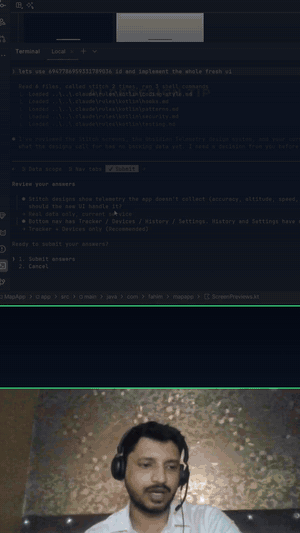

# Explainer Reel Engine

Short-form vertical (1080x1920, 30 fps) motion-graphics reels built with [Remotion](https://www.remotion.dev/).
You write a script as a JSON "job"; the engine voices it (Kokoro, ElevenLabs or local OmniVoice), times every
caption word, animates scenes on cue words, and renders an mp4. Designed to be driven by
[Claude Code](https://claude.com/claude-code): the project skills in `.claude/skills/` encode the full workflow,
but every step also runs by hand.

## Example output

Made entirely with this repo (script -> voice -> captions -> render). Preview plays right here:

[](https://www.youtube.com/shorts/CMvXPMiRqso)

*15 s preview. [Full video on YouTube](https://www.youtube.com/shorts/CMvXPMiRqso) · [mp4](docs/company-ai-layers.mp4)*

### How a reel is edited with the engine

A recorded video turned into a motion-graphics short with the same pipeline:

[](https://www.youtube.com/shorts/p7kpvb0XDtQ)

*15 s preview. [Full video on YouTube](https://www.youtube.com/shorts/p7kpvb0XDtQ) · [mp4](docs/AndroidDevelopment13_short03_motion.mp4)*

## How it works

```
jobs/<id>.json ──► tts/build_voiceover.py ──► public/<id>/voice.wav           (narration)
 (script, scenes,      │ Kokoro / ElevenLabs /   src/explainer/data/<id>.json  (scene + word timings)
  voice settings)      │ OmniVoice, cached in .cache/tts
                       ▼
        src/explainer/scriptReels.tsx  (register the composition)
                       ▼
        npx remotion render ... ──► output/<id>.mp4
```

Scenes animate on **cue words**: in a caption, `word#tag` marks the moment the `tag` animation fires.

## Quick start (about 15 minutes, no accounts, no cost)

Tested on Windows 11 with PowerShell. Full details and versions: **[requirements.md](./requirements.md)**.

1. **Install system tools**: Node.js 22+, Python 3.12, FFmpeg on `PATH`, Git.
2. **Clone and install JavaScript deps**
   ```powershell
   git clone https://github.com/ifahimkhan/explainer-reel-engine.git
   cd explainer-reel-engine\motion
   npm install
   ```
3. **Create the Python venv** (must live at `motion/.venv`)
   ```powershell
   python -m venv .venv
   .venv\Scripts\python -m pip install --upgrade pip
   .venv\Scripts\pip install -r requirements.txt
   ```
4. **Verify**
   ```powershell
   npm run typecheck
   .venv\Scripts\python -c "import kokoro, faster_whisper, soundfile; print('python ok')"
   ```
5. **Make your first reel** with the free offline Kokoro voice (first run downloads the Kokoro model):
   ```powershell
   $env:PYTHONIOENCODING="utf-8"
   .venv\Scripts\python tts\build_voiceover.py jobs\components-demo.json
   npx remotion render src/index.ts ComponentsDemo ..\output\components-demo.mp4 --codec=h264 --crf=18
   ```
   Open `output/components-demo.mp4`. To browse every composition live: `npm run studio`.

## Choose a voice engine

Set per job with `"engine"`. All engines share the TTS cache, so re-running a job only voices changed sentences.

| Engine | Cost | Setup | Best for |
|---|---|---|---|
| `kokoro` (default, omit `engine`) | free, offline | none beyond the quick start | drafts, demos |
| `elevenlabs` | paid credits (~1 per character) | API key in `motion/.env.local` (copy `motion/.env.example`), or `npx -y @elevenlabs/cli@latest onboard init` | final voice, your own clone, most expressive (`eleven_v3`) |
| `omnivoice` | free, local, CPU (~1-2 min per sentence) | separate venv, see [motion/tts/OMNIVOICE.md](motion/tts/OMNIVOICE.md) | your cloned voice without credits; copies the delivery of a reference clip |

**Your own voice:** the voice id and reference clip in this repo belong to the repo owner. Create your own
ElevenLabs clone with `motion/tts/clone_voice.py` and put its id in your job's `"voice"`, or point an
`omnivoice` job's `"refAudio"` at a 10-15 s clip of your voice (plus its transcript). Use Kokoro if you have neither.

## Make a reel

### Option A: with Claude Code (recommended)

Open the repo in Claude Code and pick a workflow:

| You have | Run | What happens |
|---|---|---|
| A script | `/reel-from-script` (attach a filled `briefs/REEL_BRIEF.md` + the script) | plans scenes, picks visuals, voices, renders |
| A reference video | put it in `reference/`, run `/reel-from-reference` | watches + transcribes it, writes your own script in the same structure |
| A problem -> fix story | `/reel-layers-story` | "layers" style reel in one persistent chat window |

Claude stops for your approval at each gate:
**plan -> free Kokoro draft -> final voice (spends credits for ElevenLabs) -> cached-only visual edits (free).**

### Option B: by hand

1. **Write a job** `motion/jobs/<id>.json` (see [Job file](#job-file) below).
2. **Voice it**
   ```powershell
   cd motion
   $env:PYTHONIOENCODING="utf-8"
   .venv\Scripts\python tts\build_voiceover.py jobs\<id>.json
   ```
   Each sentence prints `aligned` (word timestamps from the engine) or `estimated` (spread by syllables;
   normal for OmniVoice). For Kokoro/ElevenLabs, fix an `estimated` line by making the caption match what is
   spoken, or add a `"say"` with the spoken form.
3. **Register it** in `motion/src/explainer/scriptReels.tsx`:
   ```tsx
   import myReelTimeline from "./data/<id>.json";
   // ...inside SCRIPT_REELS:
   scriptReel("MyReel", myReelTimeline as Timeline),
   ```
4. **Render**
   ```powershell
   npx tsc --noEmit -p .
   npx remotion render src/index.ts MyReel ..\output\<id>.mp4 --codec=h264 --crf=18 --audio-bitrate=192k
   ```
5. **Visual-only changes later** (new visuals, cues, camera, gaps): rebuild from the cache with no TTS call,
   then render again. It refuses to synthesize, so it can never spend credits:
   ```powershell
   .venv\Scripts\python tts\build_voiceover_cached.py jobs\<id>.json
   ```
   Changing caption words, voice, model or reference clip needs `build_voiceover.py` again.

`tts\make_reel.py jobs\<id>.json <CompositionId> ..\output` runs steps 2 and 4 in one go.

**Own camera recording -> split-screen reel** (60% graphics / 40% camera, Whisper captions): a job with
`"video"`, built by `tts/build_from_recording.py`, registered in `src/explainer/split/reels.tsx`.

## Job file

Minimal job (Kokoro voice, one scene):

```json
{
  "id": "my-reel",
  "voice": "am_michael",
  "sentenceGap": 0.25,
  "sceneGap": 0.5,
  "tail": 1.5,
  "copy": {},
  "scenes": [
    {
      "id": "hook",
      "visual": { "type": "title", "label": "INTRO", "kicker": "DEV TIP", "headline": "Ship faster today", "highlight": "faster" },
      "sentences": [{ "caption": "Here is how to *ship* faster#go today." }]
    }
  ]
}
```

| Field | Meaning |
|---|---|
| `id` | slug; names `public/<id>/voice.wav` and `src/explainer/data/<id>.json` |
| `engine`, `voice`, `model`, `voiceSettings` | voice config (see [Choose a voice engine](#choose-a-voice-engine)); `omnivoice` uses `refAudio` instead of `voice` |
| `sentenceGap`, `sceneGap`, `tail` | seconds of silence between sentences, between scenes, and after the last line |
| `scenes[].visual` | what the scene shows (types below); optional `transition`, `camera`, `glitch` add-ons |
| `scenes[].sentences[].caption` | spoken text with markup: `*word*` highlight, `word#tag` animation cue, `|` caption chunk split |
| `scenes[].sentences[].say` | optional spoken form when it differs from the caption (e.g. `"n eight n"` for `n8n`) |

**Visual types**: `punch` (hook), `title`, `quiz`, `sequence`, `journey`, `chart`, `stat`, `compare`, `cards`,
`trio`, `chips`, `steps`, `reason`, `receipt`, `pair`, `swap` (paid app -> free GitHub alternative),
`terminal`, `editor`, `diff`, `tabs`, `screenshot`, `merge`, `phones`, `phoneapp`, `phoneflow`, `comment`,
`follow` (CTA), `layers`. Schemas with every field: `motion/src/explainer/scenes/generic/visuals.ts`;
usage guide and the default "house style" recipe: `.claude/skills/reel-from-script/SKILL.md`.
Real examples: any file in `motion/jobs/` (e.g. `upi-layers.json`, `free-github-swaps.json`).

## Repo layout

```
CLAUDE.md          project rules for Claude Code
requirements.md    install checklist (humans and agents)
briefs/            REEL_BRIEF.md - fill in and attach to start a new reel
.claude/skills/    reel-from-script, reel-from-reference, reel-layers-story
motion/            the Remotion project
  jobs/            one JSON per reel (script, scenes, voice settings)
  src/explainer/   scenes, components, scriptReels.tsx (composition registry), data/ (generated timelines)
  tts/             Python: voiceover engines, captions, cached rebuilds, make_reel.py
  voices/          OmniVoice reference clips + transcripts
  public/          per-reel audio, fonts, music, sfx, logo
output/            rendered reels (git-ignored)
reference/         your reference videos/screenshots (git-ignored)
```

## Troubleshooting

| Symptom | Fix |
|---|---|
| Render fails with "not a valid Remotion project" / a foreign page on `localhost:3000` | another dev server holds port 3000: add `--port=3123` to `remotion render` / `remotion still` |
| `UnicodeEncodeError` from Python | set `PYTHONIOENCODING=utf-8` (PowerShell: `$env:PYTHONIOENCODING="utf-8"`) |
| faster-whisper `metadata_errors` error | keep `av<16` (pinned in `requirements.txt`) |
| `WinError 193` when Python spawns `npx` | use `npx.cmd` on Windows (already handled in `make_reel.py`) |
| Scene shows `cue "#tag" not found` | the visual names a cue that no caption in that scene has; add `word#tag` |
| `CACHE MISS` from `build_voiceover_cached.py` | caption words or voice settings changed; run `build_voiceover.py` (approve the spend first) |
| Kokoro/Whisper model download is slow or fails | models download on first use into `motion/.cache/`; retry on a better connection |

## Security

- `motion/.env.local` / `.env` are git-ignored. Never print or commit API keys.
- `output/`, `reference/`, generated `voice.wav` files and unused voice clips are git-ignored.
- A committed voice reference clip (`motion/voices/*.wav`) lets anyone clone that voice; only commit clips you
  are fine sharing.

## License

[MIT](./LICENSE) © 2026 Fahim Khan. Bundled third-party media in `motion/public/` may carry their own rights.
OmniVoice (optional engine) is Apache-2.0 and installs separately; it is not vendored here.
